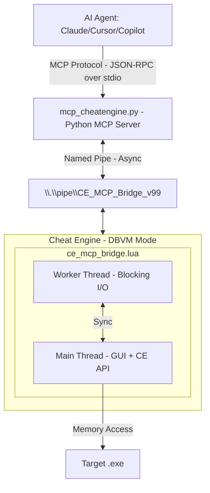

[Demo](https://github.com/user-attachments/assets/a184a006-f569-4b55-858a-ed80a7139035)

# Cheat Engine MCP Bridge

**Let multibillion $ AI datacenters analyze the program memory for you.**

Create mods, trainers, security audits, game bots, accelerate RE, or do anything else with any program and game in a fraction of a time.

[](#) [](https://python.org)

> [!NOTE]
> Thanks everyone for the stars, much appreciated! <3
> 
> Specially a big thank you to all the contributors!!
> 
> [@libangli218](https://github.com/libangli218), [@lauralex](https://github.com/lauralex), [@iamtyroon](https://github.com/iamtyroon), [@HachiroSan](https://github.com/HachiroSan), [@Attacktive](https://github.com/Attacktive)

---

## The Problem

You're staring at gigabytes of memory. Millions of addresses. Thousands of functions. Finding *that one pointer*, *that one structure* takes **days or weeks** of manual work.

**What if you could just ask?**

> *"Find the packet decryptor hook."*  
> *"Find the OPcode of character coordinates."*  
> *"Find the OPcode of health values."*  
> *"Find the unique AOB pattern to make my trainer reliable after game updates."*

**That's exactly what this does.**

_- Stop clicking through hex dumps and start having conversations with the memory._

---

## What You Get:

| Before (Manual) | After (AI Agent + MCP) |
|-----------------|---------------------|
| Day 1: Find packet address | Minute 1: "Find RX packet decryption hook" |
| Day 2: Trace what writes to it | Minute 3: "Generate unique AOB signature to make it update persistent" |
| Day 3: Find RX hook | Minute 6: "Find movement OPcodes" |
| Day 4: Document structure | Minute 10: "Create python interpreter of hex to plain text" |
| Day 5: Game updates, start over | **Done.** |

**Your AI can now:**
- Read any memory instantly (integers, floats, strings, pointers)
- Follow pointer chains: `[[base+0x10]+0x20]+0x8` → resolved in ms
- Auto-analyze structures with field types and values
- Identify C++ objects via RTTI: *"This is a CPlayer object"*
- Disassemble and analyze functions
- Debug invisibly with hardware breakpoints + Ring -1 hypervisor
- And much more!

---

## How It Works

---

## Installation

```bash
pip install -r MCP_Server/requirements.txt
```
Or manually:
```bash
pip install mcp pywin32
```

> [!NOTE]
> Native pipe mode is **Windows only** because it uses Named Pipes (`pywin32`). Use TCP relay transport when the MCP server runs outside the Windows environment that hosts Cheat Engine and cannot open the named pipe directly.

---

## Quick Start

### 1. Load Bridge in Cheat Engine
1. Enable DBVM in Cheat Engine if you plan to use DBVM tools.
2. Open Cheat Engine's Lua Engine or script executor.
   - Preferred: `File` -> `Execute Script` -> open `MCP_Server/ce_mcp_bridge.lua` -> `Execute`.
   - If your Cheat Engine build does not show `File` -> `Execute Script`, use `Table` -> `Show Cheat Table Lua Script`, paste the `dofile(...)` line below, and execute it:

```lua
dofile([[C:\path\to\cheatengine-mcp-bridge\MCP_Server\ce_mcp_bridge.lua]])
```

`ce_mcp_bridge.lua` is a loader for the modules in `MCP_Server/bridge/`, so keep the `MCP_Server` folder together. If your CE build runs the script without knowing its file name, the bridge stops with a message asking you to set the folder first:

```lua
CE_MCP_BRIDGE_DIR = [[C:\path\to\cheatengine-mcp-bridge\MCP_Server]]
dofile([[C:\path\to\cheatengine-mcp-bridge\MCP_Server\ce_mcp_bridge.lua]])
```

Re-executing the script is safe: it stops the running bridge first, including its worker thread, breakpoints and DBVM watches.

Look for: `[MCP v12.2.0] MCP Server Listening on: CE_MCP_Bridge_v99`

### 2. Configure MCP Client
Add to your MCP configuration (e.g., `mcp_config.json`):
```json
{
  "servers": {
    "cheatengine": {
      "command": "python",
      "args": ["C:/path/to/MCP_Server/mcp_cheatengine.py"]
    }
  }
}
```
Restart the IDE to load the MCP server config.

For Codex, add a TOML server block to `~/.codex/config.toml`:

```toml
[mcp_servers.cheatengine]
command = "python"
args = ['C:\path\to\cheatengine-mcp-bridge\MCP_Server\mcp_cheatengine.py']
```

Use single quotes for the Windows path so TOML treats backslashes literally.

#### TCP relay transport

The TCP relay lets `mcp_cheatengine.py` talk to Cheat Engine through a TCP socket instead of opening the Windows named pipe itself. Cheat Engine and the Lua bridge still run on Windows, while the MCP server can run anywhere that can reach the relay: another Windows process, a VM, a container, a Linux host, or a remote machine. This can also be used with WSL without changing the Lua bridge.

1. On Windows, load `MCP_Server/ce_mcp_bridge.lua` in Cheat Engine as usual.
2. On Windows, start the relay:

```powershell
python C:\path\to\cheatengine-mcp-bridge\MCP_Server\ce_tcp_relay.py --host 127.0.0.1 --port 9876
```

3. In the environment where the MCP server will run, install the MCP dependency without `pywin32`, then run/configure the MCP server with TCP transport:

```bash
python3 -m pip install -r MCP_Server/requirements-tcp.txt
```

```bash
CE_MCP_TRANSPORT=tcp \
CE_MCP_HOST=127.0.0.1 \
CE_MCP_PORT=9876 \
python3 /path/to/cheatengine-mcp-bridge/MCP_Server/mcp_cheatengine.py
```

For MCP client configs that support environment variables:

```json
{
  "servers": {
    "cheatengine": {
      "command": "python3",
      "args": ["/path/to/cheatengine-mcp-bridge/MCP_Server/mcp_cheatengine.py"],
      "env": {
        "CE_MCP_TRANSPORT": "tcp",
        "CE_MCP_HOST": "127.0.0.1",
        "CE_MCP_PORT": "9876"
      }
    }
  }
}
```

Set `--host` on the relay and `CE_MCP_HOST` on the MCP server to addresses that match your network setup. Keep the relay bound to trusted interfaces only, because anyone who can reach it can control the Cheat Engine bridge.

### 3. Verify Connection
Use the `ping` tool to verify connectivity:
```json
{"success": true, "version": "12.2.0", "message": "CE MCP Bridge Active"}
```

### 4. Start Asking Questions
```
"What process is attached?"
"Read 16 bytes at the base address"
"Disassemble the entry point"
```

---

## 214 MCP Tools Available

### Memory
| Tool | Description |
|------|-------------|
| `read_memory`, `read_integer`, `read_string` | Read any data type (`read_memory` returns compact hex by default, or base64 / an int array) |
| `read_pointer_chain` | Follow `[[base+0x10]+0x20]` paths |
| `scan_all`, `aob_scan` | Find values and byte patterns |

### Analysis
| Tool | Description |
|------|-------------|
| `disassemble`, `analyze_function`, `find_function_boundaries` | Code analysis (on x64 the exact function bounds come from the exception table) |
| `dissect_structure` | Auto-detect fields and types |
| `get_rtti_classname` | Identify C++ object types |
| `find_references`, `find_call_references` | Cross-references |

### Debugging
| Tool | Description |
|------|-------------|
| `set_breakpoint`, `set_data_breakpoint` | Hardware breakpoints with conditions (`condition="RAX == 5"`), `stop_after_hits`, and break-and-inspect (`mode="break"`: the thread stays stopped, with a watchdog that resumes it) |
| `get_halted_state`, `debug_continue` | Inspect a thread stopped by a breakpoint, then run or single-step it |
| `start_dbvm_watch` | Ring -1 invisible tracing |

### Operations and Long-Running Jobs
| Tool | Description |
|------|-------------|
| `bridge_status` | Health report: version, uptime, attached process, hardware-slot usage, job counts, request statistics, warnings. Works even when CE is unreachable |
| `read_struct` | Many typed fields (ints, floats, pointers, strings) from ONE memory read |
| `batch_commands` | Several tools in one round trip (every request is checked against the registered tools and the active profile first) |
| `start_job`, `get_job`, `get_job_result`, `wait_for_job`, `cancel_job`, `list_jobs` | Background jobs for scans and analyses: Cheat Engine stays responsive and the MCP call cannot time out |

### Binary Analysis (PE, RTTI, Cross-References)
| Tool | Description |
|------|-------------|
| `pe_info`, `pe_imports`, `pe_exports`, `pe_tls_callbacks`, `pe_functions` | Parse a loaded module's PE headers from memory: sections, imports/exports, TLS callbacks, the x64 function table (`.pdata`) |
| `va_to_rva`, `rva_to_va`, `rebase_address` | Translate addresses between Cheat Engine and IDA |
| `export_names`, `export_structures`, `import_names` | Exchange names and class layouts with IDA (ready-made IDAPython / `declare_c_type` output) |
| `rtti_scan_module`, `recover_struct` | Find MSVC classes by their RTTI; recover a class layout from live instances |
| `find_xrefs`, `find_string_refs`, `find_code_caves` | Calls, jumps, rip-relative operands, pointers and RVAs that reference an address; users of a string; free space for patches |
| `find_pointer_path` | Reverse pointer search: static `[[module+rva]+o1]+o2` chains that reach a heap address. Holders that lie close together share one memory scan. `save_as` keeps the chains in a named set for the two-run comparison |
| `compare_pointer_paths`, `list_pointer_sets`, `get_pointer_set`, `drop_pointer_set` | **Two-run pointer path comparison**: after the target restarts and you have found the same value again, `compare_pointer_paths(target=<new address>, name=<set>)` re-resolves every stored chain from its `module+RVA` base and keeps the ones that still land on it (a chain with `runs=3` survived three restarts). Near misses come back with a corrected last offset. Sets are saved to a file and survive reloads of the script and CE restarts |
| `snapshot_region`, `diff_snapshots`, `list_snapshots`, `delete_snapshot` | The "unknown value" workflow without scans: snapshot a region, then list the units that changed (or stayed the same) between snapshots |

### Patch Journal
| Tool | Description |
|------|-------------|
| `list_patches`, `undo_patch`, `drop_patches` | Every write made through `write_memory`, `write_integer`, `write_string`, `copy_memory` and `auto_assemble` is recorded with the bytes it replaced (the write's reply carries its `patch_id`). `undo_patch(id)` puts them back (a script patch runs its `[DISABLE]` section), `undo_patch(all=true)` unwinds everything newest first, and an undo is refused when the bytes changed since the patch unless `force=true`. The journal is saved to a file: after a reload of the bridge byte patches stay undoable while the same process is attached |

### Process Lifecycle
| Tool | Description |
|------|-------------|
| `open_process`, `get_process_list` | Attach to or enumerate running processes |
| `create_process` | Launch a new process under CE's control |
| `pause_process`, `unpause_process` | Suspend / resume target execution |

### Memory Allocation
| Tool | Description |
|------|-------------|
| `allocate_memory`, `free_memory` | Reserve and release memory in the target |
| `set_memory_protection`, `full_access` | Adjust page protection flags |

### Code Injection
| Tool | Description |
|------|-------------|
| `inject_dll` | Load a DLL into the target process |
| `execute_code`, `execute_method` | Run shellcode or CE Lua methods remotely |

### Symbol Management
| Tool | Description |
|------|-------------|
| `register_symbol`, `get_symbol_info` | Create and query named symbols |
| `enable_windows_symbols` | Enable PDB symbol resolution |

### Assembly / Compilation
| Tool | Description |
|------|-------------|
| `assemble_instruction` | Assemble a single x86/x64 instruction to bytes |
| `compile_c_code` | Compile C source into injected shellcode |
| `generate_api_hook_script` | Generate a CE auto-assembler API hook template |

### Window / GUI Automation
| Tool | Description |
|------|-------------|
| `find_window` | Locate a window by title or class |
| `send_window_message` | Post `WM_*` messages to a target window |

### Input Automation
| Tool | Description |
|------|-------------|
| `get_pixel` | Sample a pixel color at screen coordinates |
| `is_key_pressed`, `do_key_press` | Query and simulate keyboard input |

### Cheat Table
| Tool | Description |
|------|-------------|
| `load_table`, `save_table` | Load / save `.CT` cheat table files |
| `get_address_list` | Enumerate entries in the active cheat table |

### Kernel Mode (DBK / DBVM)
| Tool | Description |
|------|-------------|
| `dbk_get_cr3` | Read the CR3 register for the target process |
| `read_process_memory_cr3` | Read physical memory via CR3 bypass |

And many more at `AI_Context/MCP_Bridge_Command_Reference.md`

---

## Critical Configuration

### BSOD Prevention
> [!CAUTION]
> **You MUST disable:** Cheat Engine → Settings → Extra → **"Query memory region routines"**
> 
> Enabled: Causes `CLOCK_WATCHDOG_TIMEOUT` BSODs due to conflicts with DBVM/Anti-Cheat when scanning protected pages.

---

## Troubleshooting

### Cheat Engine says "too many local variables" or "Cannot find the bridge modules"

The bridge is split into modules under `MCP_Server/bridge/`, each compiled separately, so the 200-local limit no longer applies to the whole bridge. Load `ce_mcp_bridge.lua` from disk with `dofile(...)` rather than pasting it into a cheat table script, keep the `bridge/` folder next to it, and if CE still cannot find it set `CE_MCP_BRIDGE_DIR` as shown in [Quick Start](#1-load-bridge-in-cheat-engine).

### MCP client cannot connect

Check these in order:

1. Cheat Engine is open and shows `MCP Server Listening on: CE_MCP_Bridge_v99`.
2. The MCP client was restarted after adding the server config.
3. The configured `mcp_cheatengine.py` path exists.
4. `pip install -r MCP_Server/requirements.txt` has installed both `mcp` and `pywin32`.
5. Run the MCP `ping` tool. A successful connection returns `success: true` and the bridge version. `process_id: 0` is normal until Cheat Engine is attached to a target process.

---

## Security Model

The agent drives a debugger with kernel access, so decide up front how much it may do.

**Profiles.** Every tool declares one access class, and `CE_MCP_PROFILE` registers only the classes you allow:

| Class | What it may change | `readonly` | `standard` | `full` |
|-------|--------------------|:---:|:---:|:---:|
| `read` | Nothing | ✅ | ✅ | ✅ |
| `analysis` | Only CE's own analysis state: attached process, scan sessions, structures, registered symbols | ✅ | ✅ | ✅ |
| `write` | The target (memory, protection, allocations, threads, breakpoints, debugger, DBVM/DBK) or the host (files, clipboard, input, windows) | | ✅ | ✅ |
| `exec` | Anything: Lua, auto-assembler, compilers, DLL/.NET injection, remote execution, shell, loading cheat tables | | | ✅ |

`readonly` is the safe default for pure reverse engineering: no writes, no breakpoints or debugger attach, no code execution. The default is `full` for backward compatibility. The `list_toolsets` tool shows the active profile and why each tool is or isn't registered.

**Annotations.** Each tool carries MCP annotations derived from its class (`readOnlyHint` for `read`, `destructiveHint` for `write`/`exec`, `openWorldHint` for `exec`), so clients that support them can auto-approve reads and ask before anything else.

**Shell tools need two opt-ins.** `CE_MCP_ALLOW_SHELL=1` in the MCP server's environment, *and* on the Cheat Engine side either `CE_MCP_ALLOW_SHELL=1` in CE's environment or this before loading the bridge:

```lua
CE_MCP_ALLOW_SHELL = true
dofile([[C:\path\to\cheatengine-mcp-bridge\MCP_Server\ce_mcp_bridge.lua]])
```

Cheat Engine usually runs elevated, so a shell command started by the bridge runs with CE's privileges; the CE-side check is captured at load time and cannot be switched on over the pipe. The CE console logs whether shell tools are enabled when the bridge starts.

**What profiles do not do.** Profiles control what the MCP server exposes; they are not a sandbox inside Cheat Engine. Any process that can open the named pipe can send any command except the shell tools, and in `full`, `evaluate_lua` can do anything CE can. Use `readonly` or `standard` when you don't need code execution, and `CE_MCP_AUDIT_LOG` to keep a record of what was done.

---

## Environment Variables

| Variable | Default | Purpose |
|----------|---------|---------|
| `CE_MCP_TIMEOUT` | `30` | Timeout (seconds) for each MCP tool call; `<=0` disables it. A timed-out command is not retried and may still be running in Cheat Engine, so raise this for long scans. |
| `CE_MCP_PROFILE` | `full` | Which access classes get registered: `readonly` (passive: reads, scans, disassembly, structures, symbols; never touches the target or the host), `standard` (adds memory writes, breakpoints, debugger control, files, input), `full` (adds arbitrary code execution: Lua, auto-assembler, injection, shell). See [Security Model](#security-model). |
| `CE_MCP_ALLOW_SHELL` | *unset* | Set to `1` to enable `run_command` / `shell_execute`. **Arbitrary code execution risk.** Needs the CE-side opt-in too, and `CE_MCP_PROFILE=full`. |
| `CE_MCP_AUDIT_LOG` | *unset* | Path of a JSON-lines file that records every command sent to Cheat Engine (time, method, parameters, outcome, error code, duration). |
| `CE_MCP_STATE_DIR` | *see text* | Read by the **Lua bridge** (set it in Cheat Engine's environment, or as a Lua global before loading the script): folder for the saved pointer sets and patch journal. Default: the folder of `ce_mcp_bridge.lua`, else `%LOCALAPPDATA%`, else the temp folder; `off` disables saving. |
| `CE_MCP_TOOLSETS` | `all` | Comma-separated tool groups and/or presets to register. Groups: `process` (always on), `memory`, `scan`, `analysis`, `debug`, `kernel`, `scripting`, `table`, `gui`, `system`. Preset: `core`, the 63 tools a reverse-engineering session uses nearly every turn (reads/writes with the patch journal, scans, disassembly, the analysis jobs, hardware breakpoints, auto-assembler, Lua). All 214 tool schemas are ~114 k characters on every turn; `core` is ~40 k, and it combines with groups (`core,kernel`). The `list_toolsets` tool shows what each group and preset contains and what is disabled. |

---

## Example Workflows

**Finding a value:**
```
You: "Scan for gold: 15000"  →  AI finds 47 results
You: "Gold changed to 15100"  →  AI filters to 3 addresses
You: "What writes to the first one?"  →  AI sets hardware BP
You: "Disassemble that function"  →  Full AddGold logic revealed
```

**Understanding a structure:**
```
You: "What's at [[game.exe+0x1234]+0x10]?"
AI: "RTTI: CPlayerInventory"
AI: "0x00=vtable, 0x08=itemCount(int), 0x10=itemArray(ptr)..."
```

---

## Project Structure

```
README.md                               # User-facing documentation
CHANGELOG.md                            # Release notes
CLAUDE.md / AGENTS.md                   # Agent guidance (Claude Code / Codex; kept identical)

MCP_Server/
├── mcp_cheatengine.py                  # Python MCP server (FastMCP)
├── ce_mcp_bridge.lua                   # Cheat Engine bridge loader (load this in CE)
├── bridge/                             # The bridge: 32 modules (core, codec, tool areas, operations/analysis units, dispatcher)
├── ce_tcp_relay.py                     # Optional TCP-to-named-pipe relay (WSL, containers, other hosts)
├── requirements*.txt                   # Runtime, TCP-only and dev/test dependencies
├── test_mcp.py                         # Live integration test (needs CE)
├── test_json_codec.lua                 # Offline Lua tests: wire codec
├── test_pointer_parse.lua              # Offline Lua tests: pointer operand parser
└── tests/                              # Offline pytest suite (no CE needed); tests/behaviour/ = suites that run the real bridge modules in Lua 5.3

AI_Context/
├── MCP_Bridge_Command_Reference.md     # Per-command reference
├── AI_Guide_MCP_Server_Implementation.md  # Architecture and safety notes
├── CE_LUA_Documentation.md             # Cheat Engine 7.6 Lua API reference
└── Pointer_Tools_*.md                  # Design + plan for the pointer walk-back tools
```

---

## Testing

**Offline suite** (no Cheat Engine needed; runs in CI on Linux and Windows):
```bash
pip install -r MCP_Server/requirements-dev.txt
python -m pytest
```

**Behaviour suites** (part of `pytest`; also runnable on their own, with `--real` for real-DLL oracles and `--mutation` to check that they catch breakages):
```bash
python MCP_Server/tests/behaviour/run_all.py
```

**Live smoke test of the newer tools** (Cheat Engine running with the bridge loaded; spawns and attaches its own throwaway target):
```bash
python MCP_Server/tests/behaviour/live_smoke.py
```

**Live integration test** (Cheat Engine running, bridge loaded, a process attached):
```bash
python MCP_Server/test_mcp.py
```

Expected output:
```
✅ Memory Reading: 6/6 tests passed
✅ Process Info: 4/4 tests passed  
✅ Code Analysis: 8/8 tests passed
✅ Breakpoints: 4/4 tests passed
✅ DBVM Functions: 3/3 tests passed
✅ Utility Commands: 11/11 tests passed
⏭️ Skipped: 1 test (generate_signature)
────────────────────────────────────
Total: 36/37 PASSED (100% success)
```

---

## The Bottom Line

You no longer need to be an expert. Just ask the right questions.

⚠️ EDUCATIONAL DISCLAIMER

This code is for educational and research purposes only. It's created to show the capabilities of the Model Context Protocol (MCP) and LLM-based debugging. I do not condone the use of these tools for malicious hacking, cheating in multiplayer games, or violating Terms of Service. This is a demonstration of software engineering automation.
